# Лабораторная работа №3. Bubble

**1. Краткое описание выполненного:**
Создано веб-приложение «Список путешествий» с использованием no-code платформы Bubble. Сгенерирован базовый каркас приложения с помощью встроенного AI-агента, вручную доработан UI (добавлены глобальные переменные, стили и готовые компоненты). Спроектирована база данных, создана сущность «Достопримечательность» и реализована CRUD-логика (добавление и удаление записей) через workflows.

**2. Промпт дословно (из Части 1):**
Создай приложение на тему «Список путешествий». Пусть этот сайт будет публичный. Страницу обязательно создай по структуре header + body + footer. Обязательно укажи в заготовке следующую строку: «ТВП: Новицкий». Добавь несколько интерактивных элементов (реализующих CRUD).

**3. Ссылка на dev-версию приложения:**
(https://bubble.io/page?id=my-app-261022-63511&tab=Preview&name=index&type=page)

**4. Использованные AI-промпты:**
* Для создания базы данных: «Придумай структуру новой сущности 'Достопримечательность' для приложения 'Список путешествий'. Укажи 3 поля разных типов: название места (текст), дата планируемого посещения (дата) и статус (да/нет).»
* Для генерации интерфейса CRUD: «Создай интерфейс управления достопримечательностями. Нужна кнопка добавления новой записи, список всех достопримечательностей, а также кнопки для их редактирования и удаления»

**5. Какие элементы и workflows освоены:**
Освоена работа с AI-генератором Bubble, настройка Global variables (создана переменная цвета primary-novickij) и Styles. Изучен раздел Data (создание Data types и добавление записей в App Data). Настроены рабочие процессы (Workflows) для обработки нажатий кнопок: действие Data -> Create a new thing (для добавления записи) и Data -> Delete thing (для удаления записи).

**6. Скриншоты всех шагов:**
**6. Скриншоты всех шагов:**
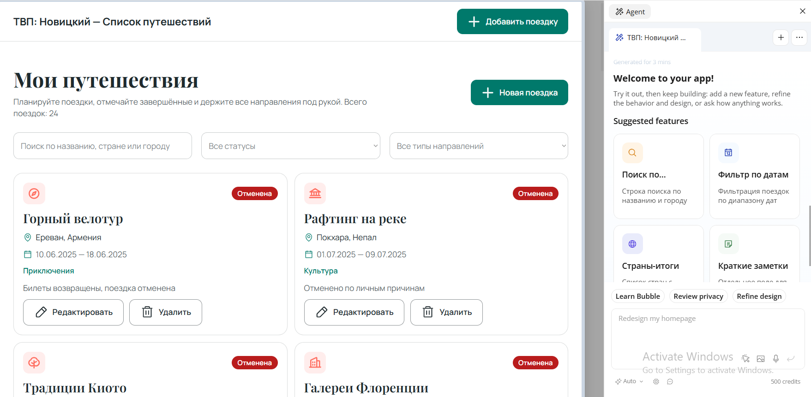
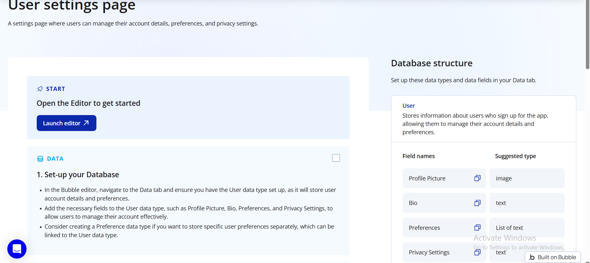
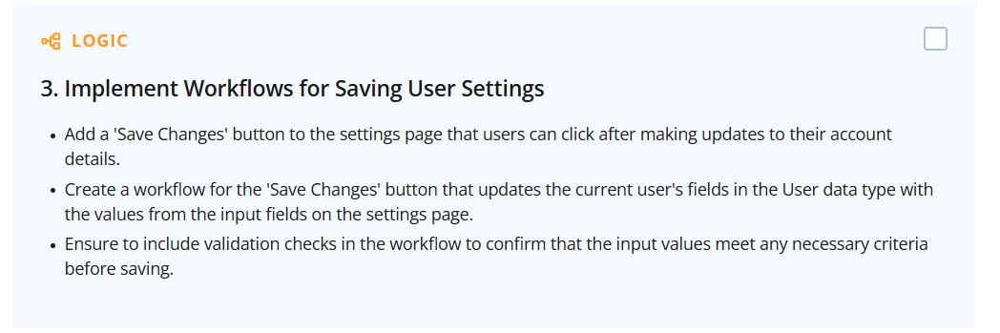
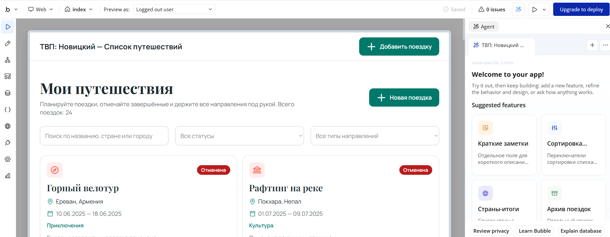
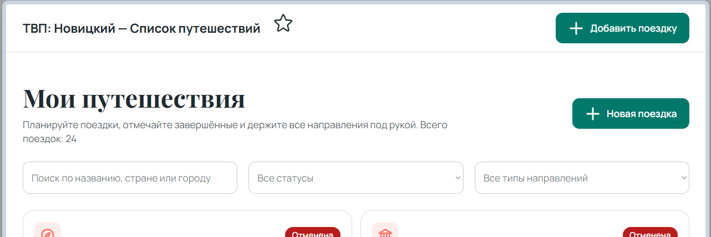
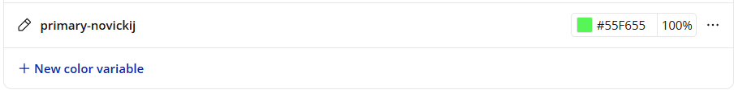
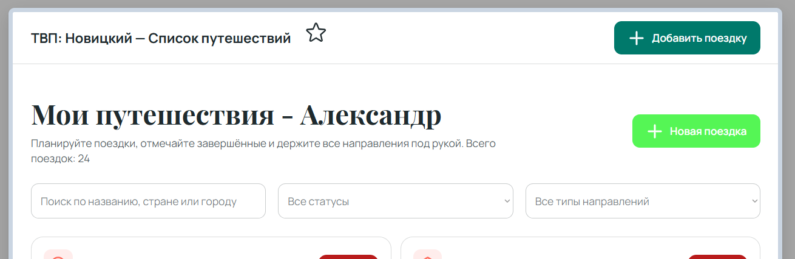
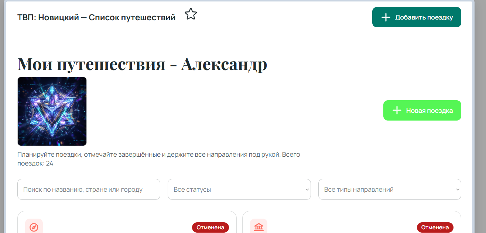
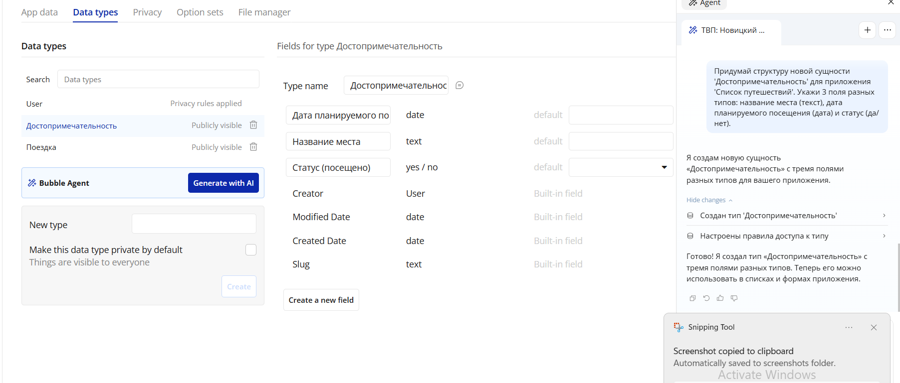
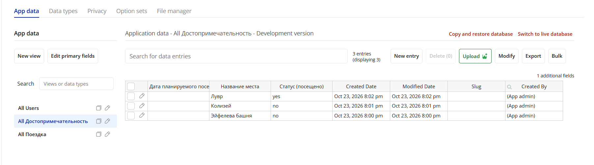
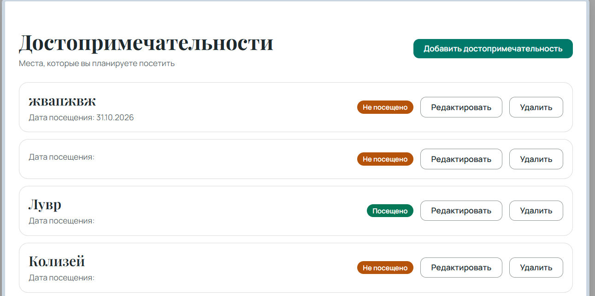
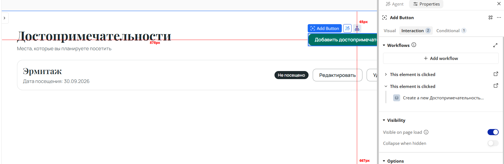
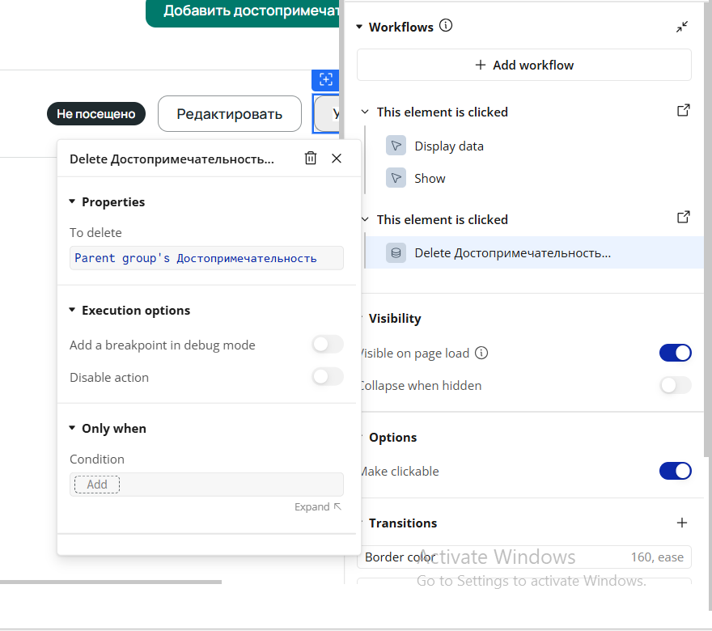
**7. Выводы:**
Платформа Bubble позволяет быстро прототипировать веб-приложения за счет AI-инструментов и визуального редактора. Главное преимущество платформы — объединение визуальной части (UI) и логики работы с базой данных (Workflows) в едином интерфейсе без необходимости писать код.