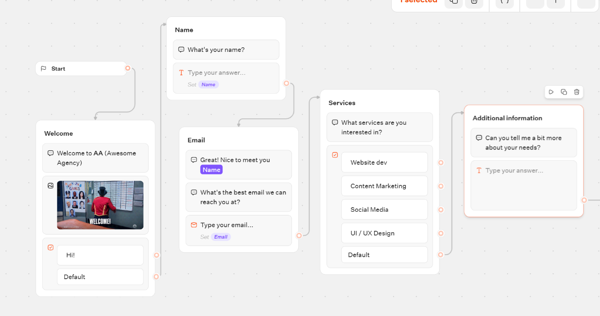
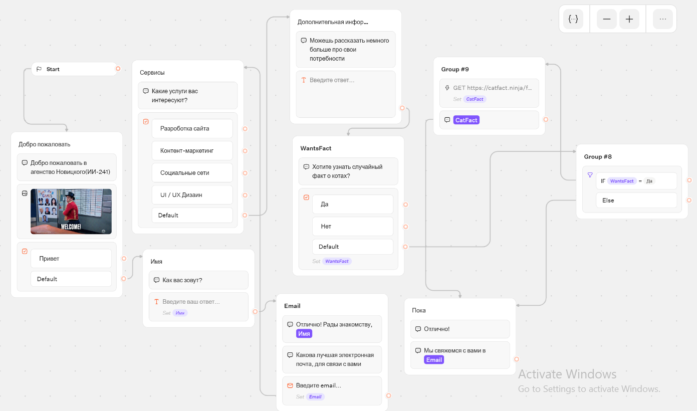
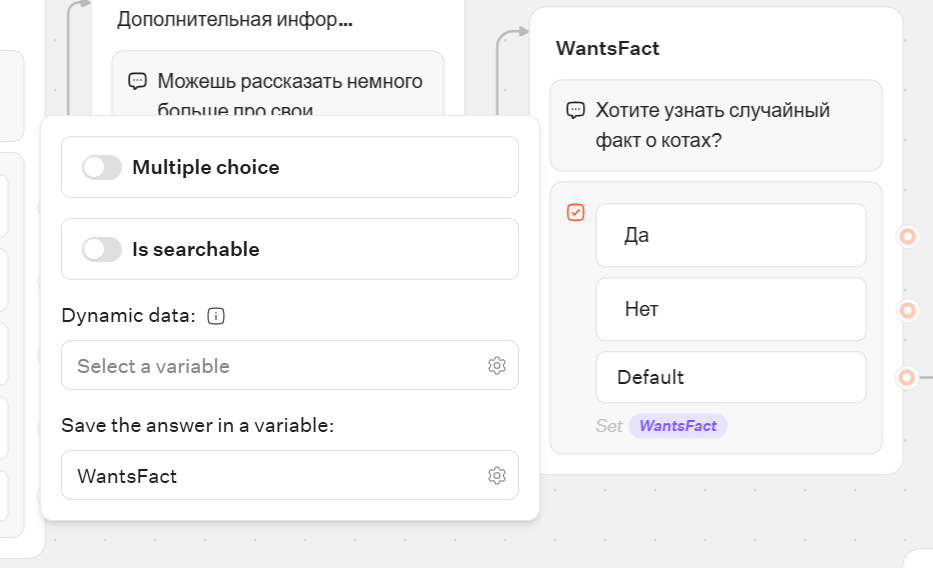
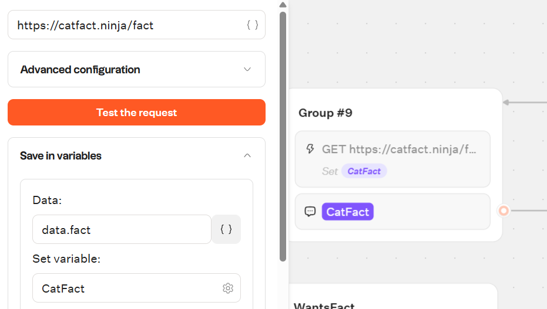
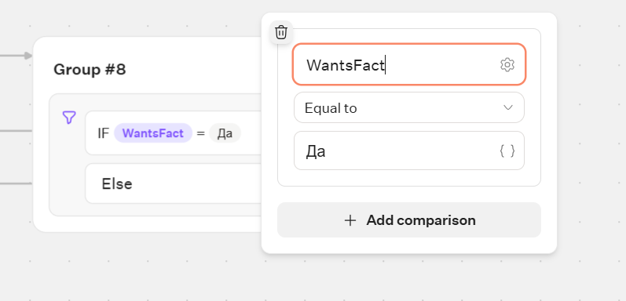
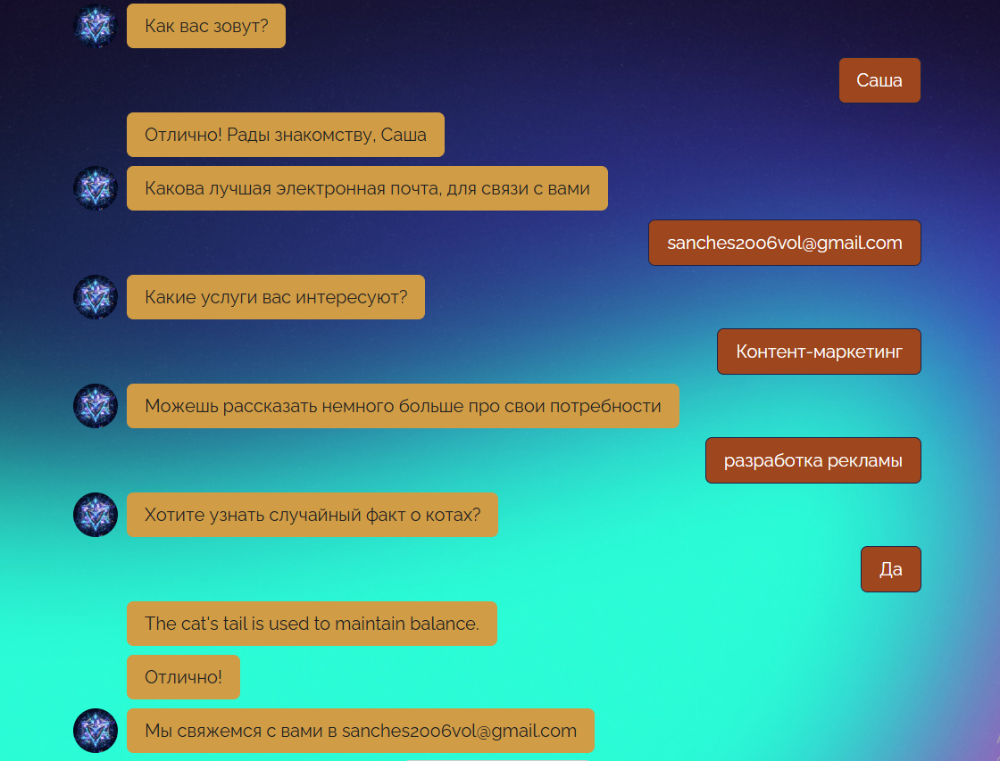

# Отчет по лабораторной работе №5
**Выполнил:** Новицкий Александр Игоревич

## 1. Краткое описание выбранного трека
В рамках лабораторной работы был выбран трек визуального программирования с использованием платформы Typebot. Целью было создание интерактивного чат-бота, который взаимодействует с пользователем, собирает данные с помощью кнопок и выполняет логическое ветвление на основе ответов. Был реализован сценарий, в котором бот предлагает узнать случайный факт о котах и, при положительном ответе, обращается к стороннему REST API (catfact.ninja) для получения данных.

## 2. Ссылка на бота и flow
[https://typebot.co/lab5-novickij-ai-241-gb64odu] - ссылка на бота
[https://app.typebot.com/typebots/snbq32om6ewdyk1kggb64odu/edit] - ссылка на flow

## 3. Использованные AI-промпты
В процессе создания и отладки сценария использовался AI-ассистент. Ключевые промпты:
1. *"исправление двойного ввода (пользователь печатает ответ вручную, а затем нажимает кнопку)"* — для поиска лишнего блока `Text input` на холсте.
2. *"после да ничего не присылает"* — для выявления ошибки в подключении стрелок к HTTP-запросу.
3. *"помоги провести все стрелки правильно"* — для настройки корректного порядка связей между блоками вопроса, условия и API.
4. *"я не могу от полного блока вонтфакт подсоединить к 8 группе только от да или нет или дефолт"* — для понимания особенностей интерфейса кнопок в Typebot.
5. *"как и где сделать скиншоты"* — для правильного сбора артефактов для отчета.

## 4. Освоенные блоки/ноды/элементы
В ходе работы были освоены следующие элементы платформы Typebot:
* **Text / Bubbles:** вывод текстовых сообщений пользователю.
* **Buttons:** создание кнопок для выбора ответа ("Да"/"Нет") и запись результата в переменную `WantsFact`.
* **Condition (Условие):** логический блок для ветвления сценария (`IF WantsFact = Да` и ветка `Else`).
* **HTTP Request:** блок для отправки GET-запроса к внешнему API (`https://catfact.ninja/fact`).
* **Variables:** сохранение данных в переменные (сохранение ответа от кнопок и извлечение ключа `fact` из JSON-ответа сервера в переменную `CatFact`).

## 5. Скриншоты workflow и диалогов
Ниже представлены скриншоты разработанного сценария и тестирования диалога:

*Схема до изменений:*

*Итоговая схема workflow:*

*Настройка переменных:*

*Настройка логического условия:*

*Результат работы (диалог):*

## 6. Выводы
В результате выполнения лабораторной работы я освоил базовые принципы визуального программирования и разработки zero-code ботов в среде Typebot. Было изучено, как выстраивать цепочки сообщений, собирать ввод от пользователя и использовать эти данные для управления ходом сценария с помощью логических блоков. Особенно важным навыком стала настройка интеграции со сторонним сервисом через HTTP-запросы и обработка полученных JSON-данных внутри переменных бота, что позволяет создавать не просто скриптовые ответы, а функциональные интеграции.