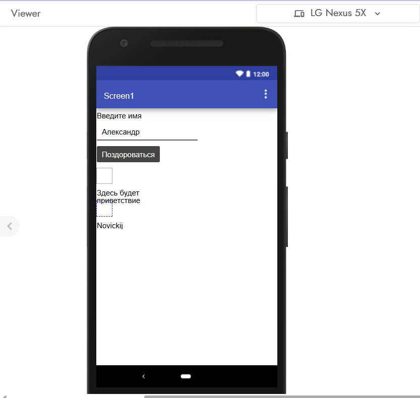
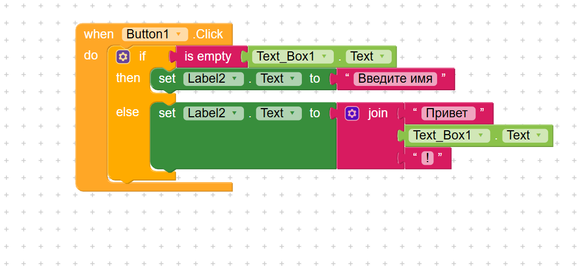
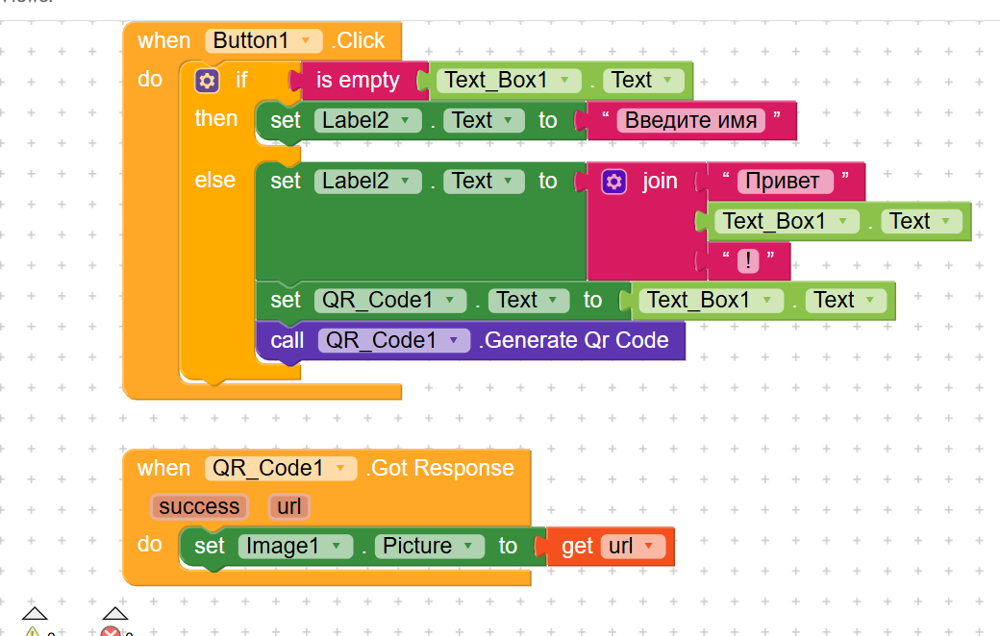
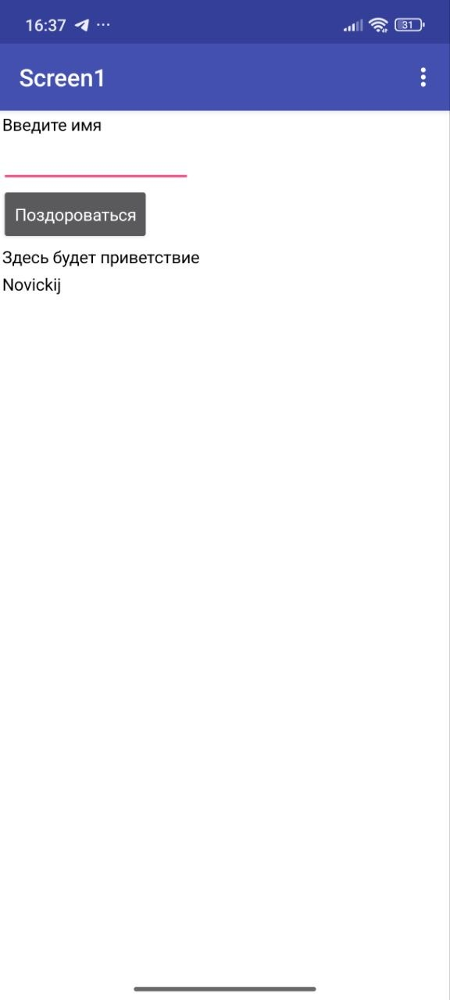
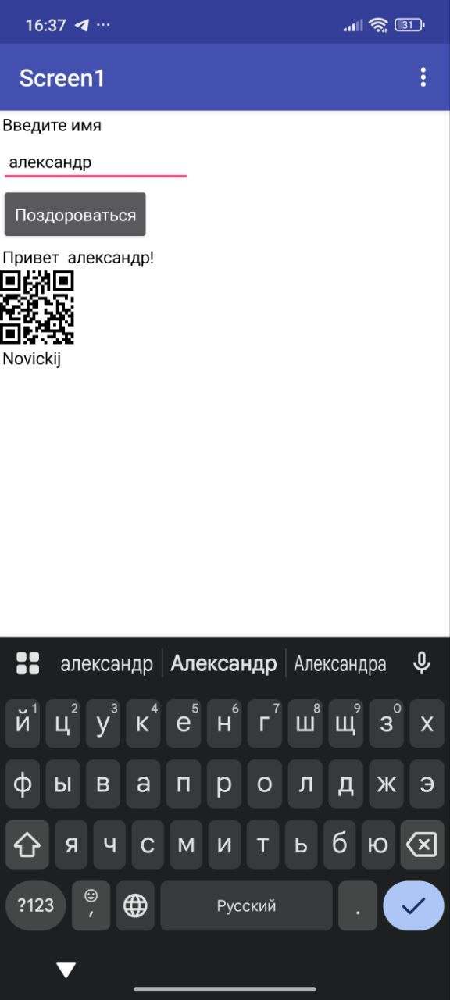
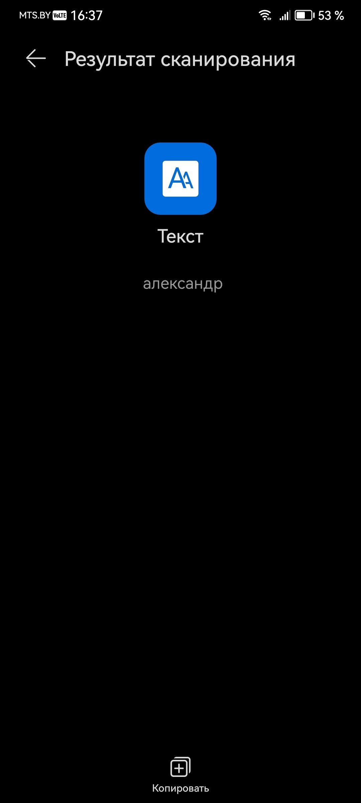

# Отчет по лабораторной работе №6: Kodular

## 1. Краткое описание приложения
В ходе лабораторной работы создано базовое мобильное приложение «Приветствие» (lab6_novitsky_hello). Приложение запрашивает у пользователя ввод имени в текстовое поле. По нажатию кнопки происходит проверка: если поле пустое, выводится просьба ввести имя, иначе выводится персональное приветствие. На главном экране размещена метка с фамилией разработчика (Novickij).

## 2. Реализованные дополнительные возможности (Ачивки)
**Ачивка 1: Генератор QR-кода**
* **Описание:** При успешном вводе имени приложение генерирует QR-код, в котором зашифровано введённое имя, и выводит его на экран в виде изображения.
* **Использованные компоненты:** Невидимый компонент `QR_Code` (из раздела Utilities) для генерации кода и `Image` для его отображения.
* **Использованные блоки:** Использован блок вызова генерации `call QR_Code.Generate Qr Code`, куда передается текст из поля ввода. Также реализована обработка асинхронного события `when QR_Code.Got Response`, внутри которого с помощью переменной `get url` ссылка на готовый код передается в картинку (`set Image.Picture to`).

## 3. Ссылка на проект
Исходный код проекта экспортирован и находится в репозитории в файле `.aia`.
Путь к файлу: `lab6/exports/lab6-novitsky.aia`

## 4. AI-промпты, использованные в работе
1. "Как собрать логику с условием if/else для проверки пустого текстового поля в Kodular?"
2. "Как правильно соединить блоки для компонента Barcode Generator, чтобы картинка появилась в Image?"
3. "Почему блоки не соединяются и выдают ошибку при установке картинки (set Image1.Picture to)?"
4. "Где находится блок 'Got Response / Got Qr Code' и как достать из него URL сгенерированной картинки?"

## 5. Освоенные компоненты и блоки
**Компоненты:**
* `TextBox` (поле ввода)
* `Button` (кнопка)
* `Label` (текстовая метка)
* `Image` (изображение)
* `Space` (для настройки отступов интерфейса)
* `QR_Code` (генератор штрих-кодов)

**Блоки:**
* Обработчики событий: `when Button.Click do`, `when QR_Code.Got Response do`
* Логика и контроль: `if / then / else`
* Текст: `is empty`, `join`
* Свойства: `set Label.Text to`, `set Image.Picture to`, получение текста `TextBox.Text` и получение переменной `get url`.

## 6. Скриншоты
Ниже представлены скриншоты интерфейса и логики из среды разработки Kodular:

**Результаты тестирования на мобильном устройстве:**
* Начальный вид приложения после запуска[cite: 12]:
  
* Успешный вывод приветствия и генерация QR-кода при вводе имени "александр"[cite: 13]:
  
* Подтверждение работы ачивки: сканирование полученного кода успешно распознало зашифрованный текст "александр"[cite: 14]:
  

## 7. Ограничения бесплатного тарифа Kodular
В процессе работы я ознакомился со следующими ограничениями бесплатной версии платформы:
* Можно создать не более 10 проектов на одном аккаунте.
* Общий размер загружаемых ассетов (картинок, звуков) ограничен 10 МБ.
* Допускается использование не более 5 сторонних расширений (extensions) в одном проекте.

## 8. Выводы
В ходе выполнения лабораторной работы я освоил базовые принципы no-code/low-code разработки мобильных приложений в среде Kodular. Научился выстраивать UI-интерфейс, работать со свойствами визуальных компонентов и применять невидимые сенсоры/утилиты. На практике изучил визуальное программирование с использованием блоков, реализовал ветвление логики (условия) и научился обрабатывать события. Дополнительно разобрался с процессом сборки (.apk) и экспорта проекта (.aia).