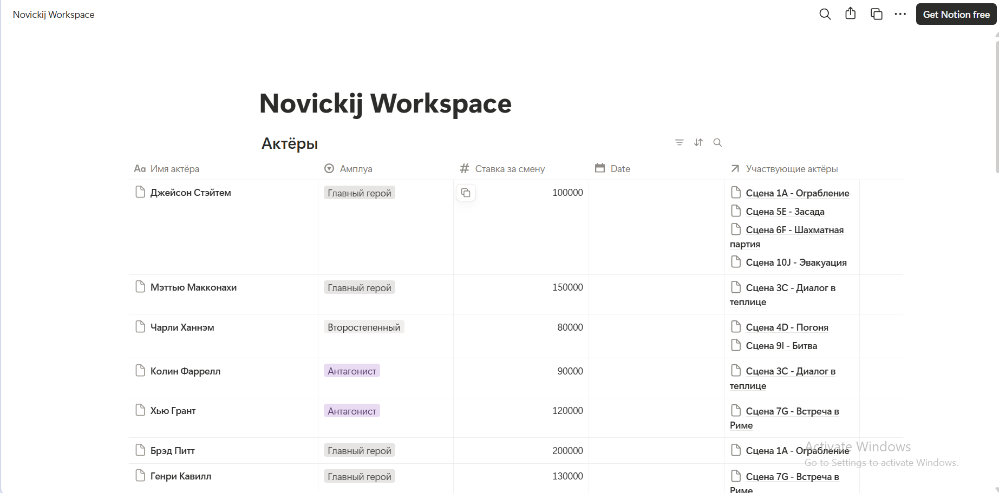
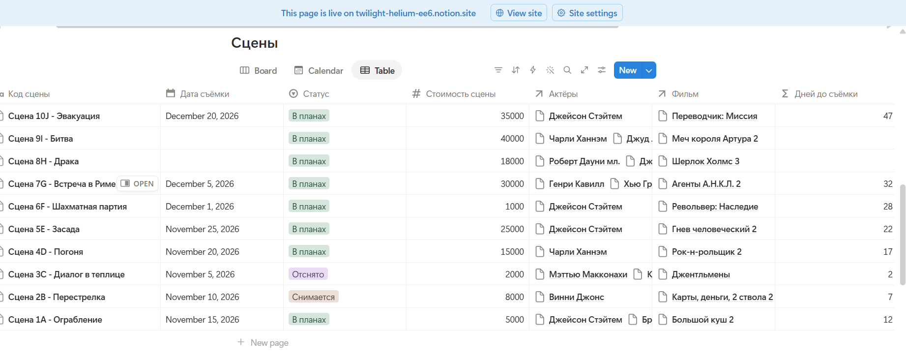
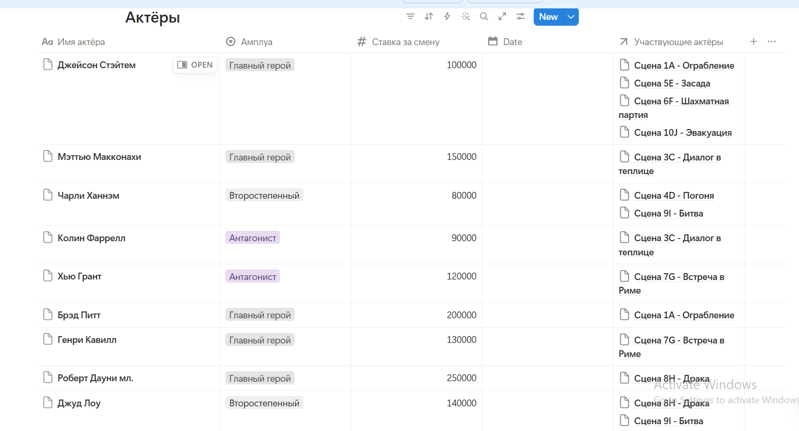
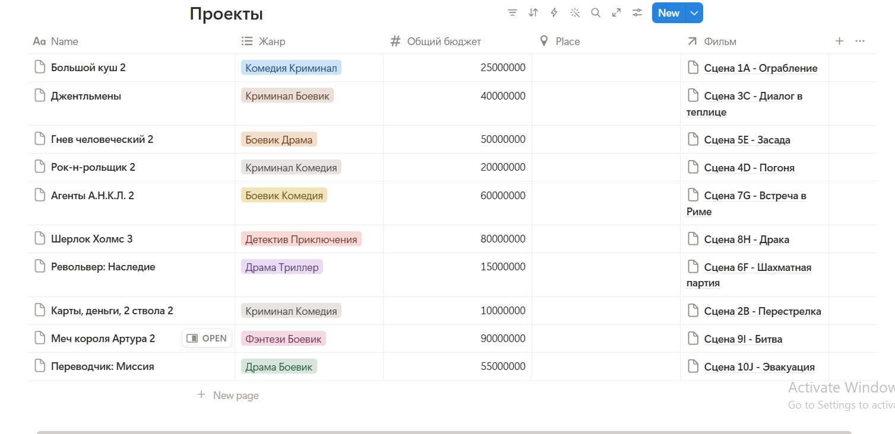
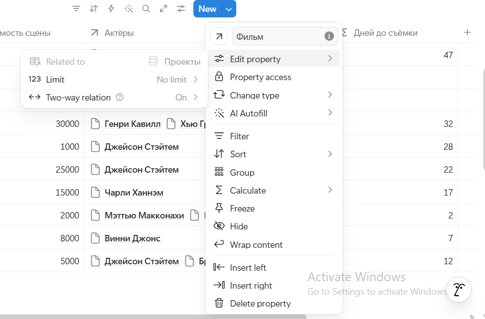
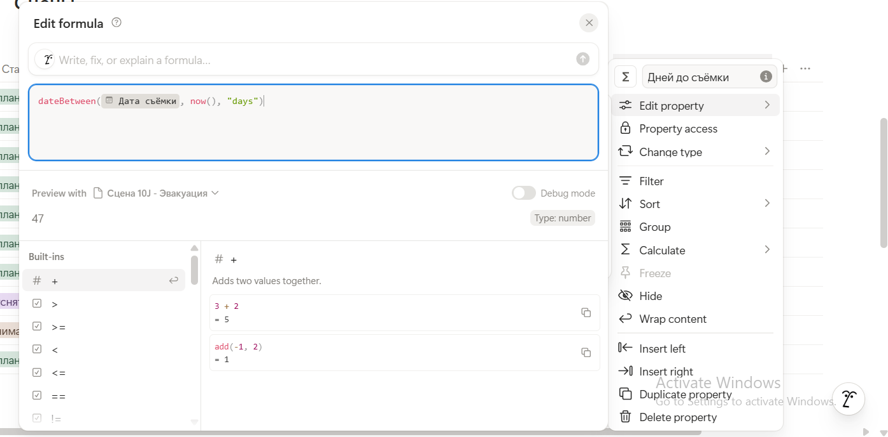
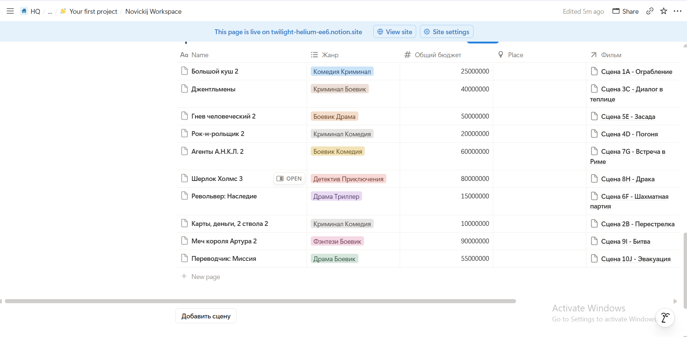
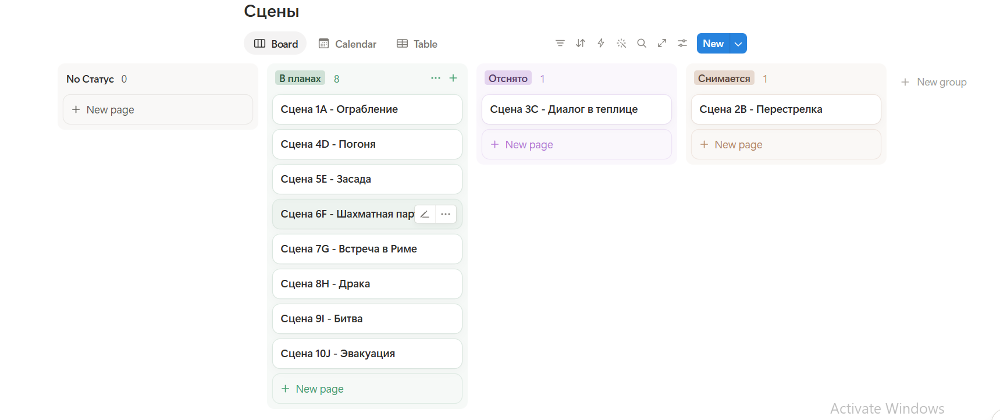
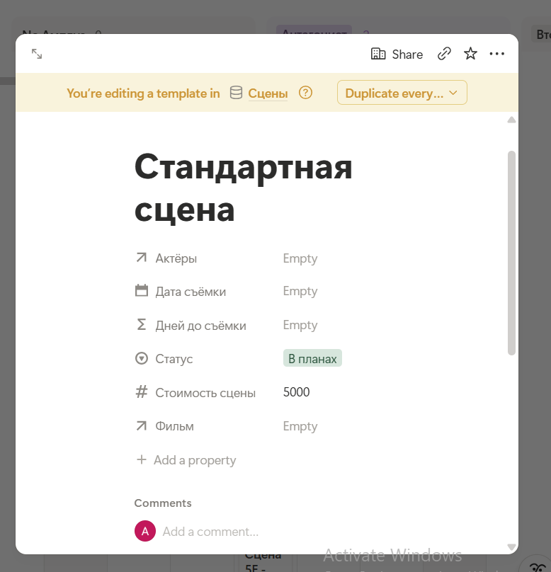
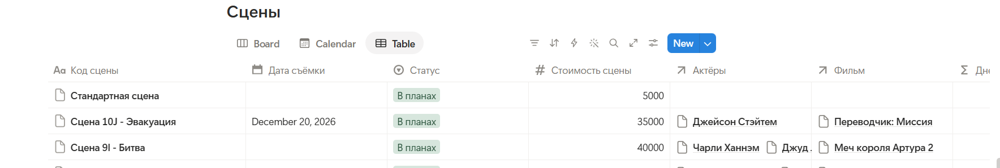

# Отчет по лабораторной работе №7: Notion

**Студент:** Новицкий Александр, группа ИИ-241

## Введение
Цель работы: освоить Notion как low-code/no-code платформу для создания баз данных, управления проектами, настройки представлений, автоматизации и интеграций.

## Глава 1. Базовое задание

**Условие:**
Создать в Notion собственное рабочее пространство с базой данных. Сгенерировать через ИИ уникальную предметную область (3-4 сущности, минимум 2 связи Relation, свойства Title, Select, Date, Number, Formula, минимум одна кнопка). Наполнить базы реалистичными данными (не менее 10 записей), настроить минимум два представления и опубликовать страницу в веб.

**Решение:**
1. **Генерация модели данных**
   * **Промпт для ИИ:** «Придумай уникальную предметную область для учебного проекта в Notion. Тема: Управление съемочным процессом кино. Нужно 3 связанные сущности, минимум 2 связи Relation, свойства типов Title, Select, Date, Number, Formula.»
   * **Ответ ИИ:** Сгенерирована модель из 3 баз: Проекты (Фильмы), Сцены, Актёры.
   * **Внесенные исправления:** Модель была реализована в исходном виде, так как полностью удовлетворила техническим требованиям задания.

2. **Реализация в Notion**
   * Создано рабочее пространство "Novickij Workspace".
   * Базы данных связаны через свойство `Relation` (Сцены привязаны к конкретным Проектам и Актёрам).
   * Добавлена формула `dateBetween(prop("Дата съёмки"), now(), "days")` для автоматического подсчета дней до начала съемок.
   * На главную страницу добавлена кнопка "Добавить сцену" (действие: Add page to -> Сцены).
   * Настроены альтернативные визуальные представления для базы сцен: Board (Канбан-доска) и Calendar (Календарь).
   * **Ссылка на опубликованный проект:** [https://twilight-helium-ee6.notion.site/Novickij-Workspace-40a1717184cb80fc962efeaef1f7e91a?source=copy_link]

3. **AI-промпты, использованные в работе**
   * "Какую уникальную предметную область выбрать для лабы по базам данных в Notion?"
   * "Как правильно написать формулу dateBetween, чтобы считать дни до даты?"
   * "Как связать базы данных через Relation и вывести данные в другой таблице?"

4. **Скриншоты базовой части**
   
   
   
   
   
   
   
   

## Глава 2. Дополнительные возможности (Ачивки)

**Условие:**
Реализовать дополнительные фичи из предложенного списка, описать использованные настройки и подтвердить их работоспособность скриншотами.

**Решение:**
* **Ачивка 7: Шаблоны записей**
  * **Описание реализации:** В базе данных "Сцены" создан новый шаблон под названием "Стандартная сцена". В настройках шаблона предзаполнены ключевые свойства: "Статус" автоматически устанавливается на тег "В планах", а "Стоимость сцены" на значение 5000. Применение данного шаблона позволяет добавлять новые сцены в один клик без ручного ввода повторяющихся данных.
  * **Скриншоты:**
    
    

## Заключение
В ходе выполнения лабораторной работы я на практике освоил платформу Notion. Были изучены принципы построения реляционных баз данных, создание связей между сущностями (Relation), написание вычисляемых свойств (Formula), а также настройка Канбан-досок и кнопок автоматизации. В процессе работы я столкнулся с ограничениями бесплатного тарифа, к которым относятся лимит на загрузку файлов объемом свыше 5 МБ и отсутствие доступа к полной истории версий страниц.

## Список исп ист
1. Официальная документация платформы Notion (раздел Help & Support).
2. ИИ-ассистент (LLM) для проектирования структуры баз данных и логики формул.